  
  
  

## Free, open-source apps

We build software and give it away. No ads, no sign-up, no tracking.

<table>
  <tr>
    <td width="50%" valign="top">
      
      <h3>Nexonic Download Manager</h3>
      Fast downloads with multiple connections, pause and resume, and video saving from popular sites. Windows, Mac, Linux and Android.  
      <a href="https://nexonictechnologies.com/project/ndm/"><b>Explore NDM →</b></a>
    </td>
    <td width="50%" valign="top">
      
      <h3>Stark AI</h3>
      A desktop AI assistant with a team of specialist agents and a built-in video studio. Mac and Windows apps, Linux from source.  
      <a href="https://nexonictechnologies.com/project/stark-ai/"><b>Explore Stark AI →</b></a>
    </td>
  </tr>
  <tr>
    <td width="50%" valign="top">
      
      <h3>Scruvix</h3>
      Removes hidden metadata from photos, videos, audio and PDFs, offline, with a simple app and a command-line tool.  
      <a href="https://nexonictechnologies.com/project/scruvix/"><b>Explore Scruvix →</b></a>
    </td>
    <td width="50%" valign="top">
      
      <h3>Nexonic IPTV</h3>
      Thousands of free live TV channels from 160+ countries in one playlist, plus apps to watch them.  
      <a href="https://nexonictechnologies.com/project/nexonic-iptv/"><b>Explore Nexonic IPTV →</b></a>
    </td>
  </tr>
  <tr>
    <td width="50%" valign="top">
      
      <h3>Nexonic TV Server</h3>
      Run your own TV server at home and watch on any smart TV, privately.  
      <a href="https://nexonictechnologies.com/project/nts/"><b>Explore NTS →</b></a>
    </td>
    <td width="50%" valign="top">
      
      <h3>Nexonic Sentinel</h3>
      A GitHub App that triages issues, reviews pull requests and keeps your repos healthy, so your inbox stays quiet.  
      <a href="https://nexonictechnologies.com/project/nexonic-sentinel/"><b>Explore Sentinel →</b></a>
    </td>
  </tr>
</table>

## What we do for businesses

<table>
  <tr>
    <td width="33%" valign="top"><b>Website Design</b> Fast, modern sites on WordPress, Shopify, Laravel or custom code, built to bring in customers.</td>
    <td width="33%" valign="top"><b>SEO &amp; Google Ranking</b> Technical SEO, content and local SEO so customers find you on Google and Google Maps.</td>
    <td width="33%" valign="top"><b>Google &amp; Meta Ads</b> Search, Maps, Facebook and Instagram campaigns managed for real leads and sales.</td>
  </tr>
  <tr>
    <td valign="top"><b>AI Automation &amp; Chatbots</b> Chatbots and workflows that answer customers and save hours every week.</td>
    <td valign="top"><b>E-commerce</b> Online stores with payments, product setup and a checkout that converts.</td>
    <td valign="top"><b>EdTech &amp; Schools</b> School websites, LMS and the systems teachers and parents use every day.</td>
  </tr>
</table>

  <a href="https://nexonictechnologies.com/services/"><b>See all services</b></a> ·
  <a href="https://nexonictechnologies.com/work/"><b>See our website work</b></a> ·
  <a href="https://nexonictechnologies.com/blog/"><b>Read the Blog &amp; News</b></a>

## How we work

| 1. Discover | 2. Design | 3. Build | 4. Grow |
|---|---|---|---|
| We learn your business, customers and goals. | We plan the pages and design the look. | We build it fast, secure and SEO-ready. | We launch, then keep improving rankings and leads. |

## Built with

  
  
  
  
  
  
  
  
  
  

## Get in touch

  
  
  
  
  
  

Nexonic Technologies · a project by <a href="https://shahrukhalid.com">Shahrukh Khalid</a>

